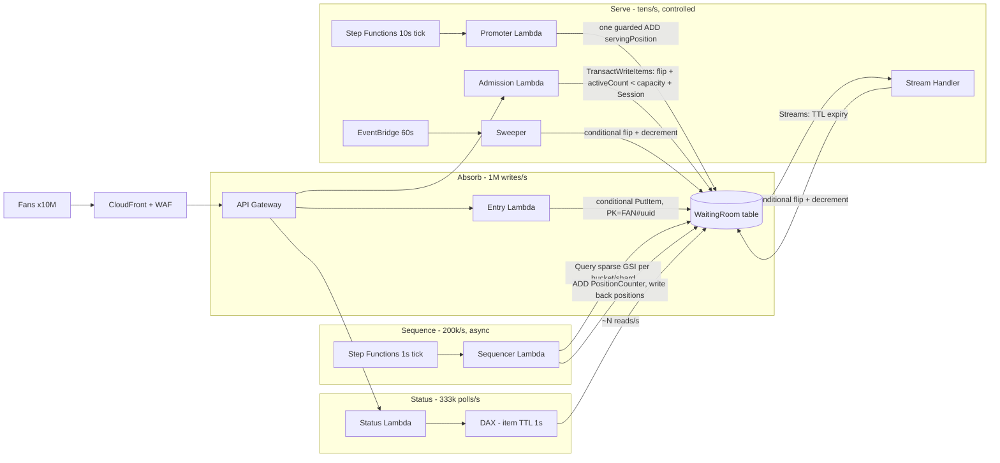
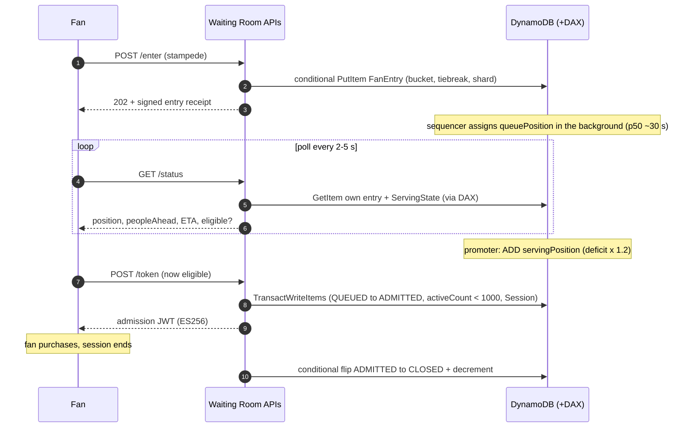
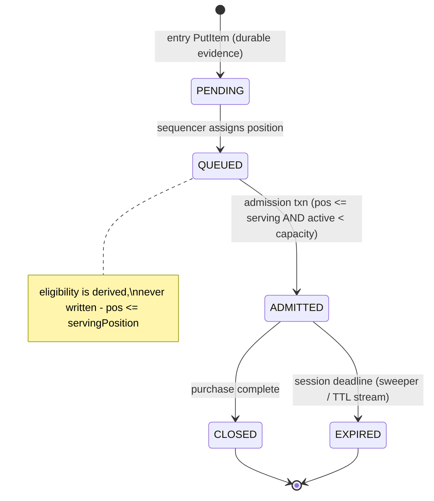

# The Virtual Waiting Room — Fairly Queuing 10 Million Fans on DynamoDB

Submission for the **AWS DynamoDB Football Data Modeling Challenge #1**
([challenge page](https://builder.aws.com/content/3FbJLetP1QgDYVWeAKsomJZATiy/the-virtual-waiting-room-fairly-queuing-1-million-fans-under-extreme-load)).
A DynamoDB-powered waiting room that absorbs a 1M-fans/second stampede, assigns every fan a
fair, verifiable queue position, and admits batches into a purchase flow hard-capped at 1,000
concurrent buyers — with real-time status for millions of simultaneous pollers.

## Executive summary

The design splits the problem into three decoupled planes — **Absorb → Sequence → Serve** —
because the three jobs have throughput requirements four orders of magnitude apart. The core
insight: *the only component that must scale to millions per second is a single write with a
perfectly distributed partition key; everything that requires global coordination is moved off
the hot path and runs at a rate we control.* Entry is one idempotent conditional `PutItem`
keyed by fan UUID — no counters, no ordering, no coordination, no hot partition possible. A
background sequencer later converts the recorded arrival evidence into integer positions at
100k–200k/s; it only ever needs to outpace admission (~5.5/s), a slack factor of ~20,000×.

Fairness is one mechanism answering two hard questions. Each fan's place is a pure function of
server-side evidence: a coarse 1-second `arrivalBucket` plus a cryptographically random
tiebreak. Fleet clock skew (≪ 1 ms with time sync) is three orders of magnitude below the
bucket width, so skew cannot reorder fans across buckets — and within a bucket, position is an
explicit uniform lottery, so a bot that fires microseconds after the on-sale opens gains
nothing over a human who taps mid-second. Because ordering is *data* (recorded evidence), not
*processing order*, retries and crashes anywhere in the pipeline can neither drop nor misorder
a fan — every write in the system is idempotent or conditionally guarded.

Promotion is the scalability centerpiece: moving a batch of fans from waiting to eligible is
**one guarded `ADD` on one item** — a monotonic `servingPosition` threshold. Eligibility is
derived (`queuePosition ≤ servingPosition`), never written per fan, so promoting 10,000 fans
costs 1 WCU, not 10,000. The threshold is deliberately soft; the hard cap is a conditional
transaction at admission (`activeCount < capacity`) that makes exceeding 1,000 active buyers
impossible regardless of promoter behavior. Millions of status polls collapse onto a DAX-cached
singleton (1 s TTL → ~N reads/s reach DynamoDB, where N = cluster nodes), and staleness is
provably safe because the threshold only moves forward. A 10M-fan discrete-event simulation
asserts all of this ([results below](#simulation-results)).

## Deliverable map

| Deliverable | Where | Short answer |
|---|---|---|
| **D1** Table design | [docs/01-table-design.md](docs/01-table-design.md) | Single table + one sparse GSI; burst path keyed by fan UUID → uniform by construction; warm throughput pre-set for the scheduled stampede |
| **D2** Fair position assignment | [docs/02-fair-ordering.md](docs/02-fair-ordering.md) | Server-side (1 s bucket, CSPRNG tiebreak); skew ≪ bucket; within-bucket lottery defeats timing games; ES256-signed position claims |
| **D3** Batch promotion | [docs/03-batch-promotion.md](docs/03-batch-promotion.md) | O(1) monotonic threshold; deficit-driven batch size; hard cap enforced by conditional transaction at admission |
| **D4** Status queries | [docs/04-status-queries.md](docs/04-status-queries.md) | Two cached reads (own item + serving singleton); DAX 1 s TTL; staleness bounded and conservative-only |
| **S1** Pinned 1,000 active | [docs/03-batch-promotion.md §6](docs/03-batch-promotion.md#6-session-lifecycle-s1-continuous-refill-no-draining) | Continuous refill: close → deficit → promote → admit; sim holds [906, 1000] with 100% band adherence |
| Correctness & failure modes | [docs/05-correctness-and-failures.md](docs/05-correctness-and-failures.md) | 13 threat entries + hot-partition audit of every item type |
| Scaling & cost math | [docs/06-scaling-and-cost.md](docs/06-scaling-and-cost.md) | Every number as formula → value, including quota constraints |
| Trade-offs & alternatives | [docs/07-tradeoffs-and-alternatives.md](docs/07-tradeoffs-and-alternatives.md) | SQS buffer, k-way merge, edge cache vs DAX, push vs poll, provisioned vs warm, fixed vs deficit batches — and limitations |

## Architecture



## Fan journey



## Fan status lifecycle



## Design decisions at a glance

| Decision | Why | Alternative rejected |
|---|---|---|
| Three planes: Absorb / Sequence / Serve | only the absorb plane needs 1M/s, and it needs zero coordination | synchronous position assignment at entry (global counter caps at ~1k/s) |
| `PK = FAN#uuid` for the burst write | uniform distribution → no hot partition can form | `PK = eventId` + position SK (one-partition stampede) |
| 1 s bucket + CSPRNG tiebreak, server-side only | skew ≪ bucket; within-bucket lottery kills timing games | microsecond timestamps (unmeasurable, skew-gameable) |
| Sparse GSI, sharded 2,048-way, KEYS_ONLY | 488 writes/s/shard at peak; index self-cleans after sequencing | k-way merge across shards for strict tiebreak order ([docs/07 §2](docs/07-tradeoffs-and-alternatives.md#2-k-way-merge-for-strict-global-tiebreak-order)) |
| O(1) promotion: monotonic `servingPosition` | 1 WCU promotes any batch size; eligibility derived, never fanned out | per-fan eligibility writes (O(batch) + partial-batch races) |
| Hard cap at admission txn, not at promotion | `activeCount < capacity` is atomic — overshoot is recoverable, overload is impossible | trusting the promoter's arithmetic |
| Deficit-driven batch size (`(target − active) × 1.2`) | closed-loop: batch = measured free capacity | fixed batches (standing 429 herd or idle slots) |
| DAX (1 s TTL) on reads only | the singleton read is impossible without a cache (~55× partition ceiling); staleness is conservative-only | per-poll strong reads; push over WebSockets ([docs/07 §4](docs/07-tradeoffs-and-alternatives.md#4-push-websocket--appsync-vs-polling)) |
| On-demand + pre-set warm throughput | scheduled stampede: guaranteed floor, pay-per-request tail | provisioned + autoscaling (minutes-slow for a 15 s burst) |
| ES256 JWTs, KMS-wrapped event key | verifiable positions/admissions, offline verification, no per-request KMS | DB lookup per verification; unsigned claims |
| TTL + Streams + 60 s sweeper for sessions | TTL lags minutes; deadline attribute + sweeper reclaim slots in seconds | trusting TTL timeliness for capacity |

## Repository contents

| Path | What | Verified how |
|---|---|---|
| [docs/](docs) | Full design (D1–D4, S1, correctness, scaling, trade-offs) | cross-linked, all numbers formula-first |
| [workbench/waiting-room-model.json](workbench/waiting-room-model.json) | NoSQL Workbench model — imports cleanly | [scripts/validate-workbench.mjs](scripts/validate-workbench.mjs) in CI: 21 sample rows, all 8 item types, all 5 fan statuses, same-bucket fans with distinct tiebreaks |
| [cdk/](cdk) | TypeScript CDK: table + sparse GSI + TTL + Streams + warm throughput, DAX cluster + 1000 ms TTL parameter group, 7 Lambda skeletons with real conditional-write logic, Step Functions tick loops, API Gateway, KMS | `cdk synth` passes cleanly (also in CI) |
| [sim/](sim) | Zero-dependency discrete-event simulator asserting the 4 invariants | run in CI; 10M-fan results below |

## Simulation results

Design-point run: **10,000,000 fans** arriving in a 15 s front-loaded stampede, ±50 ms clock
skew across 100 virtual servers, 1% lost-then-retried first attempts, 2% duplicate retries,
407 injected sequencer crashes, 30 minutes of simulated serving. Deterministic (seed 42),
6.8 s wall time. Reproduce: `cd sim && npm run sim:full`.

| Metric | Value |
|---|---|
| Positions assigned | 10,000,000 (counter 10,101,751 — 101,751 gap positions burned by 407 crashes, all harmless) |
| Time-to-position p50 / p95 / p100 | 32.4 s / 57.5 s / 61.6 s (docs/06 predicted ~28 s / ~53 s + backlog) |
| Promotions | 171 batches, deficit-driven sizes 2..1200 |
| Admissions | 9,559 (1,950 capacity-full 429s, all later admitted) |
| Peak active | **1,000 — capacity never exceeded** |
| Min active after ramp | 906; **100%** of post-ramp ticks inside [900, 1000] |

```text
Invariants:
  (a) activeCount <= capacity ........ PASS (checked every tick + every admission; peak 1000)
  (b) position order == (bucket, shard, tiebreak) ... PASS (10,000,000 fans verified)
  (c) refill band [900, 1000] ........ PASS (min 906, in-band 100.0% of post-ramp ticks)
  (d) no fan lost or duplicated ...... PASS (10,000,000/10,000,000 sequenced exactly once,
                                             across 407 crashes and 301,165 retries)

Fairness: mean position by arrival bucket (monotonic => earlier seconds strictly win)
  bucket  0 (   67,259 fans) |#                                       | mean     33,944  range [1..67,684]
  bucket  1 (1,563,078 fans) |###                                     | mean    856,521  range [67,685..1,645,662]
  bucket  2 (  966,356 fans) |########                                | mean  2,133,792  range [1,645,663..2,622,906]
  bucket  3 (  811,213 fans) |############                            | mean  3,032,887  range [2,622,907..3,441,598]
  bucket  4 (  724,560 fans) |###############                         | mean  3,807,522  range [3,441,599..4,173,730]
  bucket  5 (  664,203 fans) |##################                      | mean  4,510,009  range [4,173,731..4,845,970]
  bucket  6 (  621,623 fans) |####################                    | mean  5,158,838  range [4,845,971..5,472,350]
  bucket  7 (  587,681 fans) |#######################                 | mean  5,768,656  range [5,472,351..6,066,181]
  bucket  8 (  560,892 fans) |#########################               | mean  6,349,279  range [6,066,182..6,632,634]
  bucket  9 (  538,724 fans) |###########################             | mean  6,904,955  range [6,632,635..7,177,976]
  bucket 10 (  516,830 fans) |#############################           | mean  7,439,550  range [7,177,977..7,700,585]
  bucket 11 (  501,972 fans) |###############################         | mean  7,953,295  range [7,700,586..8,205,618]
  bucket 12 (  486,752 fans) |#################################       | mean  8,450,568  range [8,205,619..8,696,306]
  bucket 13 (  473,709 fans) |###################################     | mean  8,937,035  range [8,696,307..9,176,253]
  bucket 14 (  459,956 fans) |#####################################   | mean  9,407,785  range [9,176,254..9,640,132]
  bucket 15 (  444,294 fans) |####################################### | mean  9,864,533  range [9,640,133..10,090,853]
  bucket 16 (    9,390 fans) |########################################| mean 10,095,549  range [10,090,854..10,100,243]
  bucket 17 (    1,507 fans) |########################################| mean 10,100,997  range [10,100,244..10,101,750]
```

Read the plot: position ranges per arrival second are strictly non-overlapping (earlier
seconds always win), and gaps burned by injected crashes never break the order — the two
fairness claims, demonstrated rather than asserted. Buckets 16–18 hold the late-retry tail:
fans whose first write was lost land in the bucket where their retry durably landed, exactly
per the [fairness definition](docs/02-fair-ordering.md#4-late-writes-and-the-fairness-definition).

## References and prior art

- [DynamoDB data modeling best practices](https://docs.aws.amazon.com/amazondynamodb/latest/developerguide/bp-modeling-nosql.html) —
  the single-table, uniform-key, sparse-index discipline this model follows.
- [DAX Developer Guide](https://docs.aws.amazon.com/amazondynamodb/latest/developerguide/DAX.html) —
  item-cache TTL semantics behind the 1 s ServingState bound; this design uses DAX solely to
  make one singleton read feasible, never on any write or correctness path.
- [Virtual Waiting Room on AWS (retired solution)](https://aws.amazon.com/solutions/implementations/virtual-waiting-room-on-aws/) —
  issued opaque queue numbers from a counter; this design instead derives order from recorded
  evidence (bucket + random tiebreak), making positions verifiable and the entry path
  coordination-free.
- [SeatGeek's virtual waiting room on DynamoDB + Lambda (AWS Architecture Blog)](https://aws.amazon.com/blogs/architecture/build-a-virtual-waiting-room-with-amazon-dynamodb-and-aws-lambda-at-seatgeek/) —
  closest production prior art; this design differs in the O(1) derived-eligibility promotion
  (no per-fan eligibility writes) and the explicit within-bucket lottery with a published
  statistical-equivalence argument.

## License

[MIT](LICENSE)
