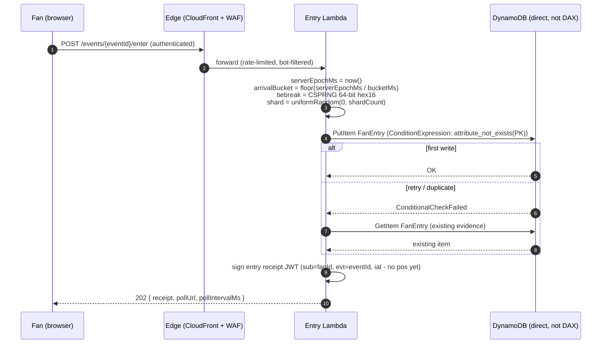

# D1 — Table Design

> **Deliverable D1:** A DynamoDB data model for the waiting room queue covering fan identifier,
> queue position, entry timestamp, eligibility status, and batch assignment, with a key schema
> optimized for extreme concurrent write bursts.

## 1. Design goals

The design point for the whole repository:

| Parameter | Value | Source |
|---|---|---|
| Event size | 10,000,000 fans | challenge statement |
| Peak arrival rate | 1,000,000 entries/s, sustained ~15 s | challenge statement ("within seconds") |
| Purchasing capacity | 1,000 concurrent active purchasers | stretch goal S1 |
| Mean session length | 180 s | assumption (see [doc 06](06-scaling-and-cost.md)) |

The single hard requirement this table must satisfy: **absorb ~1M writes/s for ~15 seconds
without a hot partition and without losing or duplicating a single fan.** Everything else in
the system (sequencing, promotion, admission) runs at rates we control, on partitions we keep
deliberately cold.

## 2. Single table `WaitingRoom`, one sparse GSI

Generic keys `PK` (S) / `SK` (S); every item carries a `type` attribute.

### 2.1 Item catalog

| Item | `PK` | `SK` | Key attributes | Written by | Write rate (design point) |
|---|---|---|---|---|---|
| `FanEntry` | `FAN#<fanId>` | `EVT#<eventId>` | `arrivalBucket` (N), `tiebreak` (S, 16 hex), `shard` (N), `status` (`PENDING`→`QUEUED`→`ADMITTED`→`CLOSED`/`EXPIRED`), `queuePosition` (N, set by sequencer), `batchId` (S), `enteredAt` (N, server epoch ms), `gsi1pk`/`gsi1sk` (S, sparse — removed after sequencing), `ttl` (N) | Entry API, Sequencer | ~1M/s burst (entry), then 100–200k/s (position write-back) |
| `PositionCounter` | `EVT#<eventId>` | `CTR#POSITION` | `value` (N) | Sequencer (`ADD value :chunk`) | ≤ ~400/s (batched, page size 500) |
| `ServingState` | `EVT#<eventId>` | `STATE#SERVING` | `servingPosition` (N), `positionsAssigned` (N), `rateEmaPerSec` (N), `updatedAt` (N), `eventState` (`PRE`/`OPEN`/`PAUSED`/`CLOSED`) | Promoter | ~1 write / 5–15 s |
| `ActiveCounter` | `EVT#<eventId>` | `CTR#ACTIVE` | `activeCount` (N), `capacity` (N) | Admission txn, session close | tens/s |
| `EventConfig` | `EVT#<eventId>` | `CONFIG` | `bucketMs`, `shardCount`, `capacityTarget`, `overshootFactor`, `sessionTtlSec`, `batchPolicy` | Ops | rare |
| `Batch` | `EVT#<eventId>` | `BATCH#<batchId>` | `fromPosition`, `toPosition`, `size`, `promotedAt` | Promoter | ~1 / tick |
| `Session` | `EVT#<eventId>` | `SESSION#<fanId>` | `status` (`ACTIVE`/`CLOSED`), `admittedAt`, `deadline` (N, epoch ms), `expiresAt` (N, DynamoDB TTL) | Admission txn, close paths | tens/s; partition holds ≤ ~capacity live items (bounded) |
| `Lease` | `EVT#<eventId>` | `LEASE#SEQUENCER` | `owner` (S), `expiresAt` (N) | Sequencer | heartbeat, ~1/15 s |

All five attributes the challenge names are first-class:

- **fan identifier** → `PK = FAN#<fanId>`
- **queue position** → `queuePosition`
- **entry timestamp** → `enteredAt` (raw evidence) and `arrivalBucket` (the value ordering is
  actually computed from — see [doc 02](02-fair-ordering.md))
- **eligibility status** → *derived*: `eligible ⇔ queuePosition ≤ servingPosition`. It is never
  written per fan; see [doc 03](03-batch-promotion.md) for why this is the centerpiece of the
  design.
- **batch assignment** → `batchId` on the fan item plus a `Batch` audit item per promotion.

### 2.2 Why `PK = FAN#<fanId>` survives the stampede

The stampede write is a single `PutItem` keyed by a fan UUID. UUIDs are uniformly distributed
by construction, so 1M writes/s spread evenly across however many partitions the table has —
there is **no hot partition to mitigate because none can form**. No counter, no "next position"
read-modify-write, no ordering work happens on this path (that is Decision A, the three-plane
split: Absorb → Sequence → Serve).

Compare the naive alternative — `PK = EVT#<eventId>`, `SK = <position>` — which funnels the
entire event into one partition (~1,000 WCU/s ceiling) and requires a global counter at 1M/s.
That design fails at roughly 0.1% of the required scale.

### 2.3 Idempotent entry write (no drops, no duplicates)

```
PutItem
  Item: FanEntry{PK=FAN#<fanId>, SK=EVT#<eventId>, status=PENDING, arrivalBucket, tiebreak, shard, gsi1pk, gsi1sk, enteredAt, ttl}
  ConditionExpression: attribute_not_exists(PK)
```

- First attempt wins and records the fan's arrival evidence durably.
- Any retry (client timeout, network flap, duplicate tap) hits `ConditionalCheckFailedException`;
  the handler then reads the existing item and returns the same receipt. **Idempotent by
  condition** — a fan can retry forever and exists exactly once.
- The write goes **directly to DynamoDB, never through DAX** (writes bypass the cache by
  design — Decision E).

Every other write in the system follows the same discipline; each one is called out inline in
the doc that describes it, and collected in the
[correctness doc](05-correctness-and-failures.md#4-retries-and-at-least-once-delivery).

### 2.4 Why the `EVT#<eventId>` partition is safe

All coordination items (`PositionCounter`, `ServingState`, `ActiveCounter`, `EventConfig`,
`Batch`, `Session`, `Lease`) share the `EVT#<eventId>` partition. They are deliberately
**separate items** so their write-contention profiles don't interfere, and so `ServingState`
stays a clean, cacheable singleton. Aggregate write rate on that partition at the design
point:

| Writer | Rate |
|---|---|
| `PositionCounter` `ADD`s | ≤ 400/s (200k/s write-back ÷ 500 page size; the second sweep pass adds only straggler noise) |
| Admission txns (`ActiveCounter` + `Session`) | ~2 × 5.5/s ≈ 11/s steady, ≤ ~100/s during ramp |
| Session closes (`ActiveCounter` + `Session`) | same order |
| `ServingState` + `Batch` | ≤ 0.4/s |
| `Lease` heartbeat | ≤ 0.1/s |
| **Total** | **≤ ~600 WCU/s, below the ~1,000 WCU/s per-partition write ceiling** |

Single-item counters cannot benefit from adaptive-capacity partition splits (a single item
lives on exactly one partition), which is precisely why the design keeps their write rates
low and batched. Full audit: [hot-partition audit table](05-correctness-and-failures.md#10-hot-partition-audit).

### 2.5 Position gaps are harmless (state this once, rely on it everywhere)

The sequencer reserves position ranges with an atomic counter `ADD`, then writes positions
back to fan items. If it crashes between the two, a range of positions is burned and never
assigned. This is **harmless by construction**: eligibility is the threshold comparison
`queuePosition ≤ servingPosition`, not an enumeration of positions. A gap only means the
serving threshold occasionally admits slightly fewer real fans than its nominal batch size —
which the deficit-driven promoter ([doc 03](03-batch-promotion.md)) corrects on the next tick.

## 3. GSI1 — `SequencingIndex` (sparse, self-cleaning)

```
gsi1pk = B#<eventId>#<arrivalBucket>#<shard>     shard ∈ [0, shardCount), uniform random at entry
gsi1sk = <tiebreakHex16>#<fanId>
Projection: KEYS_ONLY
```

- **Purpose:** the only structure in the system that groups fans by arrival bucket, so the
  background sequencer can read each bucket in canonical order (`gsi1sk` ascending = random
  tiebreak order) and assign integer positions.
- **Sparse:** only `PENDING` items carry `gsi1pk`/`gsi1sk`. The sequencer's write-back
  `REMOVE`s both, so sequenced fans drop out of the index. The index holds only the
  unsequenced backlog (design point: < ~60 s of arrivals), stays small, and costs nothing at
  rest.
- **`KEYS_ONLY` projection suffices:** the write-back needs `fanId` (parsed from `gsi1sk`) and
  `eventId` (parsed from `gsi1pk`) to address the base item — nothing else. Smallest possible
  index items, cheapest possible index writes.

### 3.1 Shard-count math

A single GSI partition sustains ~1,000 WCU/s. At the design-point peak, one 1-second arrival
bucket receives up to 1,000,000 index writes in that second. Required shards with headroom:

```
shardCount ≥ peakArrivalsPerSec / 800        (800 WCU/s per shard = 20% headroom)
           ≥ 1,000,000 / 800 = 1,250  →  2,048 (next power of two, generous)
```

Per-shard write rate at peak: `1,000,000 / 2,048 ≈ 488 writes/s` — under half the partition
ceiling. The shard is chosen uniformly at random server-side at entry time, so shard load is
balanced by construction and — because it is random — contributes to fairness rather than
fighting it (see the [statistical-equivalence argument](02-fair-ordering.md#5-within-bucket-order-shard-major-is-statistically-fair)).

**Cost note:** every `FanEntry` put costs 1 WCU (base table, item < 1 KB) **+ 1 WCU** (GSI1,
KEYS_ONLY item < 1 KB). GSI writes double the burst write cost; see
[doc 06](06-scaling-and-cost.md) for totals.

## 4. Capacity mode: on-demand + pre-configured warm throughput

**On-demand alone is insufficient for a scheduled stampede.** On-demand scales to roughly 2×
a table's previous peak; ramping beyond that risks throttling exactly when the on-sale opens.
But a ticket on-sale is the rare gift of a *scheduled* stampede — we know the time to the
minute. So:

- Set **warm throughput** on the table and on GSI1 before the event:
  `warm ≥ 1.2 × expected peak` → **1,200,000 write units/s on the table and 1,200,000 on
  GSI1**.
- Keep billing on-demand: pay per request, no capacity planning for the long tail after the
  burst.
- **Operational reality:** default per-table on-demand quotas are far below
  this (40k write units/s in most regions). An event at this scale requires a service-quota
  increase and an AWS capacity engagement well before the on-sale. DynamoDB serves workloads
  of this magnitude (documented at Prime Day scale), but not by default on a fresh account.

The alternative — provisioned capacity with scheduled auto-scaling for the event window — is
analyzed in [doc 07](07-tradeoffs-and-alternatives.md#5-provisioned--scheduled-scaling-vs-on-demand--warm-throughput).

Table settings summary:

| Setting | Value | Why |
|---|---|---|
| Billing | On-demand | burst-then-tail workload |
| Warm throughput (table) | 1.2M write units/s, 500k read units/s | pre-warm for scheduled burst; warm reads absorb the fan-item polls that pass through the 1 s DAX cache (~167k RCU/s, [doc 04 §5.2](04-status-queries.md#52-fan-items-the-part-the-cache-does-not-help)) |
| Warm throughput (GSI1) | 1.2M write units/s | index takes the same burst |
| TTL | attribute `ttl` | post-event cleanup of `FanEntry`; session expiry on `expiresAt` (`Session` items reuse the table TTL attribute name `ttl` in the implementation; docs use `expiresAt` for clarity) |
| Streams | `NEW_AND_OLD_IMAGES` | TTL-expiry close path for sessions ([doc 03](03-batch-promotion.md#6-session-lifecycle-s1-continuous-refill-no-draining)) |

## 5. Component spec: Entry API — `POST /events/{eventId}/enter`

### 5.1 Flow



Steps 3–4 are the entire hot path: compute three server-side values, one conditional write.
No reads, no counters, no coordination.

1. **Authenticate** — upstream identity is assumed (one entry per authenticated fan);
   identity depth is out of scope ([limitations](07-tradeoffs-and-alternatives.md#8-limitations)).
2. **Compute evidence server-side** — `arrivalBucket`, `tiebreak`, `shard`. Client-supplied
   timestamps are never accepted, anywhere in the system.
3. **Conditional put** — idempotent (§2.3).
4. **Respond `202`** with a signed entry receipt (JWT per Decision F, without `pos` — the
   position claim is added after sequencing; see [doc 02 §7](02-fair-ordering.md#7-verifiable-positions-signed-tokens)) and polling instructions.

### 5.2 Edge assumptions (breadth belongs elsewhere; depth belongs to DynamoDB)

Stated briefly and not over-engineered — this is a data-modeling challenge:

- CloudFront in front of the API (TLS termination, geographic fan-in, static waiting-room
  page).
- API Gateway with account limits raised for the event window, or an ALB where regional quota
  math favors it.
- AWS WAF rate-limiting per IP/fingerprint ahead of the Lambda.

The load-bearing claim is about DynamoDB: given a uniformly distributed key and pre-warmed
throughput, the *database* absorbs the stampede; the HTTP tier's job is only to fan requests
in, which is a solved, horizontally-scalable problem.

### 5.3 Failure modes

| Failure | Behavior | Why it is safe |
|---|---|---|
| Client retry / duplicate submit | `ConditionalCheckFailed` → return existing receipt | idempotent conditional put (§2.3) |
| Lambda crash after put, before response | client retries; same path as above | evidence already durable; fan's ordering unaffected |
| Lambda crash before put | client retries; new attempt lands in the bucket where it durably lands | fairness is defined on durable arrival ([doc 02 §4](02-fair-ordering.md#4-late-writes-and-the-fairness-definition)) |
| Throttling despite warm throughput | SDK retry with jitter; entry is idempotent so retries are safe | uniform key spreads retries too; warm throughput sized at 1.2× peak |
| DAX outage | none on this path | entry writes never touch DAX |

## 6. Sample items

```jsonc
// FanEntry, just arrived (PENDING, still carries sparse GSI keys)
{
  "PK": "FAN#7c9e6679-7425-40de-944b-e07fc1f90ae7",
  "SK": "EVT#CUPFINAL2026",
  "type": "FanEntry",
  "status": "PENDING",
  "arrivalBucket": 1783142100,
  "tiebreak": "3fa85f6457174562",
  "shard": 1042,
  "enteredAt": 1783142100237,
  "gsi1pk": "B#CUPFINAL2026#1783142100#1042",
  "gsi1sk": "3fa85f6457174562#7c9e6679-7425-40de-944b-e07fc1f90ae7",
  "ttl": 1783228500
}

// FanEntry, sequenced (QUEUED — GSI keys removed, position + batch assigned)
{
  "PK": "FAN#550e8400-e29b-41d4-a716-446655440000",
  "SK": "EVT#CUPFINAL2026",
  "type": "FanEntry",
  "status": "QUEUED",
  "arrivalBucket": 1783142100,
  "tiebreak": "1b4f0e9851971998",
  "shard": 17,
  "queuePosition": 4211,
  "batchId": "B-000009",
  "enteredAt": 1783142100091,
  "ttl": 1783228500
}

// ServingState singleton — the one hot read, cached by DAX
{
  "PK": "EVT#CUPFINAL2026",
  "SK": "STATE#SERVING",
  "type": "ServingState",
  "servingPosition": 5200,
  "positionsAssigned": 9834021,
  "rateEmaPerSec": 5.4,
  "updatedAt": 1783142260000,
  "eventState": "OPEN"
}
```

The full sample set — every item type, every fan status, including three fans in the same
bucket with different tiebreaks — is in the
[NoSQL Workbench model](../workbench/waiting-room-model.json).
