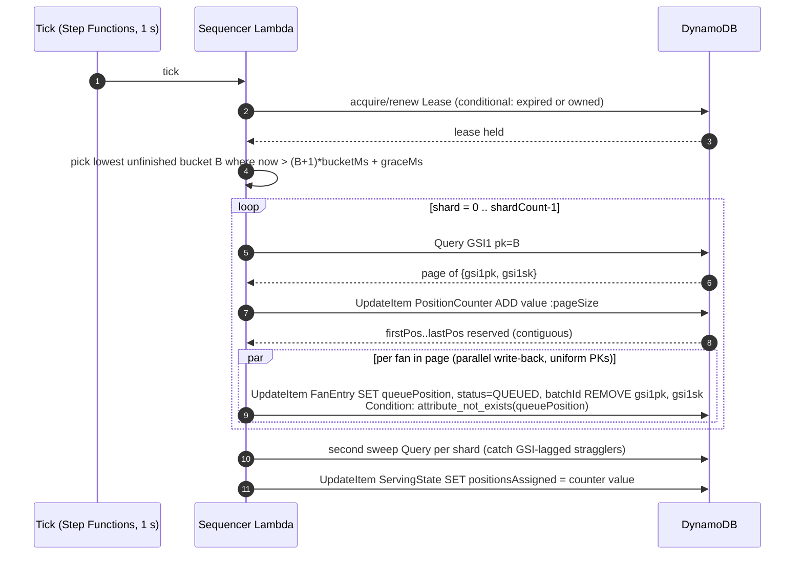

# D2 — Fair Position Assignment

> **Deliverable D2:** How fans are assigned a fair queue position when they arrive, explicitly
> covering clock skew and near-simultaneous arrivals at scale, and how queue-position gaming
> is prevented.

## 1. The canonical order

Every fan's place in line is a pure function of three values recorded durably at entry time,
all generated **server-side**:

```
arrivalBucket = floor(serverEpochMs / bucketMs)          bucketMs = 1000 (EventConfig)
shard         = uniformRandom(0, shardCount)             shardCount = 2048
tiebreak      = CSPRNG 64-bit value, fixed-width hex16
```

**Canonical ordering:** `arrivalBucket` ascending, then (within a bucket) `shard` ascending,
then `tiebreak` ascending. Earlier seconds strictly beat later seconds; within the same
second, position is a uniform lottery.

Client timestamps are never read, never trusted, never transmitted — the entry Lambda stamps
everything. This single mechanism is the answer to both hard sub-questions the challenge
asks:

## 2. Clock skew

The fleet's clocks only need to agree to well under `bucketMs`. With Amazon Time Sync Service
(chrony against a fleet-local reference), EC2/Lambda clock error is typically **well under
1 ms**, and single-digit milliseconds in degraded cases. Against a 1,000 ms bucket:

```
P(fan lands in adjacent bucket due to skew) ≤ maxSkewMs / bucketMs ≈ 1 / 1000 = 0.1%
```

- The *worst possible* effect of skew is displacement by **one bucket** — one second of
  queue — and only for fans arriving within `maxSkewMs` of a bucket boundary.
- Within a bucket, order is random anyway, so sub-bucket skew has **zero** effect on expected
  position.
- Compare the alternative (microsecond-precision timestamps as the sort key): skew of even a
  few ms systematically favors fans routed to a fast-clock server — a real, exploitable,
  headline-generating unfairness. Coarse bucketing deliberately throws away precision that
  could never be trusted at fleet scale.

## 3. Near-simultaneous arrivals at scale

At 1M arrivals/s, a 1 s bucket holds up to ~1,000,000 fans whose true order is physically
unknowable (network jitter between a fan's tap and the Lambda invocation is tens of
milliseconds — orders of magnitude larger than any timestamp precision we could record).
The design's position:

- **Between buckets:** strict FIFO at 1-second granularity — arriving genuinely earlier
  genuinely helps.
- **Within a bucket:** a uniform lottery via `tiebreak`. This is the *fairest possible*
  treatment of arrivals whose order cannot be honestly measured: every fan in the same second
  has an identical position distribution, independent of their network path, device speed, or
  luck of server routing.

There is no thundering-herd write problem either: the entry write is keyed by fan UUID
(uniform), the GSI write is spread over 2,048 random shards — see
[doc 01 §2.2 and §3.1](01-table-design.md) for the partition math.

## 4. Late writes and the fairness definition

**Effective arrival is when the system durably saw you.** A fan whose first attempt is lost
(timeout, crash before the put) and whose retry lands at `t+3 s` is sequenced with the bucket
where the write actually landed. This is stated as a definition, not hidden as an edge case:
the queue orders *recorded evidence*, and evidence exists only once it is durable. The
alternative — honoring a claimed earlier arrival — would require trusting client-side claims,
which is exactly what this design forbids.

## 5. Within-bucket order: shard-major is statistically fair

The sequencer reads a bucket shard-by-shard (`shard 0..2047`), each shard internally ordered
by `tiebreak` (the GSI sort key). So the realized within-bucket order is
**(shard, tiebreak)**, not a global sort of tiebreak alone.

**Equivalence argument.** Both `shard` and `tiebreak` are uniform random draws made
server-side at entry, independent of anything the fan controls (identity, timing within the
bucket, network path). Therefore the composite key `(shard, tiebreak)` is an i.i.d. uniform
random label, exactly as a single wider random tiebreak would be. For any two fans in the same
bucket, `P(A before B) = 1/2`; every within-bucket permutation induced by `(shard, tiebreak)`
is equally likely, which is the definition of a uniform lottery. The distribution of any fan's
position is *identical* to the global-tiebreak-sort design — no fan can tell which one is
running from any number of observations.

**What it buys:** the alternative — a strict global sort on tiebreak across shards — requires
a 2,048-way k-way merge streaming from 2,048 GSI partitions in lockstep (rejected; analyzed in
[doc 07 §2](07-tradeoffs-and-alternatives.md#2-k-way-merge-for-strict-global-tiebreak-order)).
Shard-major processing needs one shard in memory at a time, trivially checkpoints between
shards, and parallelizes cleanly. Same fairness, far simpler machinery.

## 6. Gaming prevention

| Attack | Defense | Mechanism |
|---|---|---|
| Timing optimization (scripted sub-ms entry at on-sale open) | Within-bucket lottery | a bot that fires at `t+1 ms` and a human who taps at `t+800 ms` draw from the same position distribution; speed buys nothing inside a bucket |
| Multiple entries per fan | Idempotent conditional put + identity | `attribute_not_exists(PK)` — one durable entry per authenticated `fanId`, retries return the original |
| Forged / inflated position claims | Signed tokens (§7) | position claims are ES256 JWTs; downstream verifies offline against the JWKS; a fan cannot mint or alter `pos` |
| Bot floods / Sybil (many identities) | Edge layering — scope note | WAF rate limits per IP/fingerprint and upstream identity proofing reduce but do not eliminate Sybil pressure; full bot-detection depth is out of scope ([limitations](07-tradeoffs-and-alternatives.md#8-limitations)). The queue's contribution: it never *amplifies* bot advantage, because speed does not translate into position |

## 7. Verifiable positions: signed tokens

Positions must be *verifiable* — a fan can prove their place, and no fan can forge a better
one.

- **Entry receipt** (issued at `202`): ES256 JWT, claims `sub=fanId`, `evt=eventId`, `iat`;
  no `pos` yet.
- **Position claim** (available once sequenced, returned by the status API on request):
  adds `pos=queuePosition`.
- **Admission grant** (issued by the admission API): adds short `exp` (session deadline) and
  `jti=sessionId`. Downstream purchase services verify this offline — no DB read needed to
  trust that a fan was legitimately admitted.
- **Key handling:** one event-scoped ES256 keypair, generated once with KMS
  `GenerateDataKeyPair`; the private key lives decrypted only in the signing Lambda's memory
  (ciphertext at rest in its env/config), the public key is published at a JWKS endpoint.
  **KMS is deliberately not called per request** — per-request `Sign` at admission rates is
  affordable, but the status path may attach position claims at thousands/s, where per-request
  KMS calls would add a quota-bound dependency and per-call cost for zero security gain over
  in-memory signing with a KMS-wrapped key.

## 8. Component spec: Sequencer

The sequencer is the asynchronous middle plane (Decision A): it converts durable arrival
evidence into integer positions. It runs at a rate *we* choose — it must outpace admission
(~tens/s) and, for good UX, assign positions within tens of seconds; it never needs to match
the 1M/s arrival rate.

### 8.1 Flow



### 8.2 Rules

- **Single logical sequencer per event**, enforced by the `Lease` item: conditional acquire
  (`attribute_not_exists(expiresAt) OR expiresAt < :now OR owner = :me`), heartbeat renewal.
  Even a double-running sequencer **cannot corrupt state**: the counter `ADD` is atomic, and
  per-fan assignment is conditional on `attribute_not_exists(queuePosition)` — a race burns
  gap positions ([harmless](01-table-design.md#25-position-gaps-are-harmless-state-this-once-rely-on-it-everywhere)) but never double-assigns or reorders.
- **Watermark rule:** process bucket `B` only when `now > (B+1)·bucketMs + graceMs`, with
  `graceMs = 2000`. This covers straggler writes still in flight at bucket close and GSI
  eventual-consistency lag (typically well under a second). A **second sweep pass** per bucket
  runs before the bucket is marked complete; anything the sweep finds landed late and is
  appended in canonical `(shard, tiebreak)` order at that point. A write that lands after even
  the sweep is sequenced with the bucket its write actually landed in (§4).
- **Write-back is conditional and idempotent:** `attribute_not_exists(queuePosition)` — a
  crashed-and-restarted sequencer re-reading a half-processed page cannot overwrite positions;
  the GSI `REMOVE` makes processed fans vanish from the index, so restart re-work shrinks to
  the unprocessed remainder.

### 8.3 Throughput math

| Quantity | Formula | Value |
|---|---|---|
| Counter ceiling | ~1,000 `ADD`/s on one item | 1,000/s |
| Position allocation ceiling | `counterCeiling × pageSize` = 1,000 × 500 | 500,000 positions/s |
| Write-back budget (the real limit) | Lambda concurrency knob; uniform PKs so DynamoDB side is already warm | 100k–200k updates/s |
| Counter `ADD` rate at 200k/s write-back | 200,000 / 500 | 400/s (well under ceiling) |
| Full sequencing time, 10M fans @ 200k/s | `10M / 200k` | ~50 s (+ 3 s watermark) |
| Full sequencing time, conservative 100k/s | `10M / 100k` | ~100 s |
| p50 time-to-position @ 200k/s | watermark + 5M/200k | ~28 s ✓ (< 30 s target) |
| p100 time-to-position | 3 + 10M/200k ≈ 53 s; conservative: ~103 s | ✓ (< 3 min target) |

The invariant that actually matters, stated once and relied on everywhere:
**sequencing throughput ≫ admission throughput at all times.** Admission drains ~5.5 fans/s
steady-state ([doc 06](06-scaling-and-cost.md)); the sequencer sustains 100,000+/s. The
promoter additionally guards `servingPosition ≤ positionsAssigned`
([doc 03 §3](03-batch-promotion.md#3-the-promoter-algorithm-deficit-driven)), so even a stalled
sequencer degrades to "queue pauses", never to a correctness violation.

- **Trigger:** a Step Functions loop (`Wait` 1 s → invoke → repeat) or a self-rescheduling
  Lambda. **Not** EventBridge Scheduler — its minimum rate is 1 minute; it cannot tick
  sub-minute. (EventBridge does fine for the 60 s sweeper.)

### 8.4 Failure modes

| Failure | Behavior | Why it is safe |
|---|---|---|
| Sequencer crash mid-page | restart re-queries shard; already-written fans left the GSI; remainder gets fresh positions; the reserved-but-unwritten range becomes a gap | conditional write-back + sparse index; gaps harmless |
| Two sequencers (lease race, e.g. clock issues on lease expiry) | both run; atomic counter + conditional per-fan writes prevent double assignment; extra gaps burned | correctness never depends on the lease — the lease is an efficiency device |
| GSI lag > grace | second sweep pass catches items; beyond that, late items sequence into their durable-landing bucket | watermark + sweep + fairness definition (§4) |
| Counter throttling | pages retry with backoff; allocation slows, never corrupts | `ADD` is atomic; ordering comes from the GSI read order, not counter timing |
| Step Functions tick missed | next tick processes backlog; buckets are processed low-to-high, order preserved | bucket order is data, not schedule |
