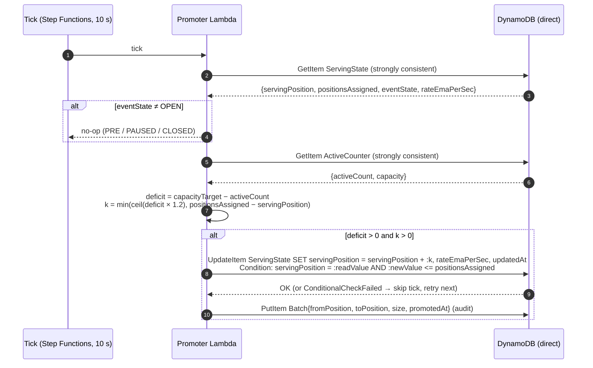
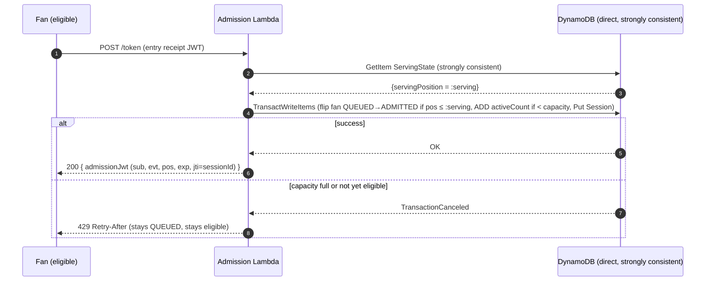

# D3 — Batch Promotion Strategy (+ S1 Stretch: Continuous Refill to 1,000)

> **Deliverable D3:** How groups of fans move from `waiting` to `eligible to browse` — how
> batch size is determined, what triggers promotion, and how over-promotion beyond purchasing
> capacity is prevented.
>
> **Stretch S1:** Keep the number of active purchasers pinned at 1,000, continuously refilling
> from the waiting room as slots free up — without waiting for all slots to empty.

## 1. The centerpiece: O(1) promotion via a monotonic serving threshold

Promotion in this design is **one guarded update on one item**:

```
UpdateItem  EVT#<eventId> / STATE#SERVING
  UpdateExpression:    ADD servingPosition :k
  ConditionExpression: servingPosition + :k <= positionsAssigned  (via SET guard, see §3)
```

Eligibility is **derived, never written per fan**:

```
eligible(fan) ⇔ fan.queuePosition ≤ servingPosition
```

Promoting a batch of 10,000 fans therefore costs **1 WCU, not 10,000**. There is no fan-out
write, no batch job touching 10,000 items, no window during which "half a batch" is eligible.
The threshold moves once, atomically, and every fan at or below it is eligible by definition
the next time they (or anyone) reads `ServingState`.

This is the property that makes everything else cheap: the status path reads one cached item
([doc 04](04-status-queries.md)), the promoter writes one item per tick, and the per-fan write
rate after sequencing is zero until the fan themselves acts (admission).

`servingPosition` is **monotonically non-decreasing** — it only ever moves forward via `ADD`
with a non-negative operand. Monotonicity is what makes stale reads of it safe everywhere
(§5, [doc 04 §4](04-status-queries.md#4-staleness-bound-and-why-it-is-safe)).

## 2. What triggers promotion, and how batch size is determined

**Trigger:** a promoter tick every 5–15 s (default **10 s**), driven by a Step Functions
`Wait` loop (EventBridge Scheduler cannot tick sub-minute). Each tick:

1. Read `ActiveCounter` — **strongly consistent, direct DynamoDB, not DAX** (this read feeds
   a control decision; Decision E routes all correctness-relevant reads around the cache).
2. Compute the deficit and promote (§3).

**Batch size is demand-driven, not fixed** — this is the direct answer to "how is batch size
determined":

```
deficit   = capacityTarget − activeCount          e.g. 1000 − 850 = 150
batchSize = ceil(deficit × overshootFactor)       e.g. 150 × 1.2  = 180
```

The batch is exactly as large as the purchasing system's measured free capacity, inflated by
`overshootFactor = 1.2` to compensate for promoted fans who never show up (walk-aways,
abandoned tabs). A **fixed-size fallback policy** exists in `EventConfig.batchPolicy` for the
`PRE → OPEN` ramp: the first tick after opening admits an initial batch of
`capacityTarget × overshootFactor` (there is no admission-rate history yet), after which the
deficit loop takes over.

## 3. The promoter algorithm (deficit-driven)



Properties worth naming:

- **Never promote positions that don't exist yet:** the condition caps the new threshold at
  `positionsAssigned` (maintained by the sequencer). If sequencing ever stalls, promotion
  pauses instead of inviting fans who have no position — graceful degradation, not corruption.
- **Idempotent / race-safe:** the update is conditioned on the value the promoter just read
  (`servingPosition = :readValue`), so a duplicated tick (Step Functions at-least-once, two
  overlapping executions) can move the threshold at most once per read — the loser gets
  `ConditionalCheckFailed` and simply waits for its next tick. Called out per the
  every-write-is-guarded discipline.
- **Audit trail:** one `Batch` item per promotion records `[fromPosition, toPosition]`, size,
  and time — the analytics/dispute record for "when did position N become eligible".
- **ETA support:** the promoter maintains `rateEmaPerSec` (exponential moving average of
  admissions/s, computed from `ActiveCounter` deltas + closes since the last tick) inside
  `ServingState`, so one cached read gives clients everything ETA math needs
  ([doc 04 §3](04-status-queries.md#3-what-the-client-computes)).
- **Kill switch:** the promoter no-ops unless `eventState = OPEN`. `PAUSED` freezes the
  threshold (fans keep their positions, status API tells clients to hold quietly); `CLOSED`
  ends the event ([doc 05 §12](05-correctness-and-failures.md#12-sellout--event-close)).

## 4. Why over-promotion cannot overwhelm purchasing: the two-layer control

The serving threshold is deliberately **soft** — it grants the *right to request admission*,
nothing more. The hard gate is the admission transaction (Decision D):

```
TransactWriteItems:
  1. UpdateItem FanEntry:      SET status = ADMITTED
       Condition: status = QUEUED AND queuePosition <= :serving
  2. UpdateItem ActiveCounter: ADD activeCount :1
       Condition: activeCount < capacity   -- attribute on the same item; "capacity" is a
                                           -- DynamoDB reserved word, aliased in code
  3. PutItem Session:          {status: ACTIVE, admittedAt, deadline, expiresAt}
       Condition: attribute_not_exists(PK)  (idempotency guard)
```

All three succeed or none do. Even if the promoter overshoots wildly — bug, operator error,
`overshootFactor` misconfiguration — **the purchasing system cannot exceed `capacity`**,
because every admission atomically increments a counter that refuses to pass it. Overshoot
merely means some eligible fans see `429` and retry (§5). This is the two-layer control:

| Layer | Component | Type | Failure effect |
|---|---|---|---|
| Flow shaping | Promoter (`servingPosition`) | soft, tunable | too many eligible → brief 429s; too few → idle slots until next tick |
| Hard cap | Admission txn (`activeCount < capacity`) | atomic, absolute | none — this is the invariant |

The simulator ([/sim](../sim)) asserts `activeCount ≤ capacity` at every step under injected
overshoot and races; see the results in the [README](../README.md#simulation-results).

## 5. Component spec: Admission — `POST /events/{eventId}/token`



- **TOCTOU note:** `:serving` is read just before the transaction and could be stale by the
  time the transaction commits. Because `servingPosition` is monotonically non-decreasing
  (§1), a stale read is only ever **conservative** — it can reject a fan who just became
  eligible (they retry seconds later), never admit one who isn't. Documented once here;
  the same monotonicity argument covers DAX staleness on the status path.
- **Idempotency:** condition on `status = QUEUED` makes the flip exactly-once; a retried
  admission call after a success returns the existing session (handler reads the `Session`
  item on `TransactionCanceled` where the cancellation reason is the fan-status condition).
- **Cost note:** transactions cost 2× WCU per item (6 write units per admission across 3
  items). At tens of admissions/s this is noise — the expensive machinery sits exactly where
  volume is lowest. That asymmetry is deliberate: cheap and lock-free at 1M/s (entry),
  transactional and strict at 5–100/s (admission).
- On success the admission JWT is signed (ES256, [doc 02 §7](02-fair-ordering.md#7-verifiable-positions-signed-tokens)); downstream purchase services verify it offline.

### Failure modes

| Failure | Behavior | Why it is safe |
|---|---|---|
| Two concurrent admissions, one slot left | txn engine serializes; exactly one `ADD` passes the `< capacity` condition | atomic transactional check |
| Lambda crash after txn, before response | client retries; `status = QUEUED` condition fails; handler returns existing session/JWT | conditional flip = exactly-once |
| Stale `:serving` read | conservative rejection only | monotonic threshold |
| Fan spams /token before eligible | condition `queuePosition ≤ :serving` fails; 429 | no state change, no counter movement |

## 6. Session lifecycle (S1: continuous refill, no draining)

The refill loop **never waits for slots to empty**. Sessions end one by one; the counter
falls; the next promoter tick (≤ 10 s later) tops the eligible pool back up; admissions
refill the slots. Active count hovers in a tight band just under target, continuously:

```
close paths (any of):                    refill:
  purchase complete  ─┐
  session TTL expiry ─┼─→ conditional flip FanEntry ADMITTED→CLOSED/EXPIRED
  sweeper (deadline) ─┘      + ADD activeCount −1
                                   │
                                   ▼
        promoter tick: deficit = 1000 − activeCount → ADD servingPosition
                                   │
                                   ▼
        newly eligible fans call /token → admitted → counter rises
```

### 6.1 The one idempotency argument (all three close paths funnel through it)

Every close path executes the same two-step guarded sequence. The flip lives on the
**`FanEntry`** item — the durable anchor that outlives the TTL-deleted session item:

```
1. UpdateItem FanEntry:      SET status = CLOSED   (or EXPIRED, by path)
     Condition: status = ADMITTED           ← the flip; fails if already closed
2. UpdateItem ActiveCounter: ADD activeCount −1     ← executed only if step 1 succeeded
   (+ SET Session.status = CLOSED, if the session item still exists)
```

Step 1 is a compare-and-set: for a given fan it can succeed **exactly once**, no matter how
many times any path retries. Step 2 runs only on a successful flip, so the decrement is
exactly-once per session even under at-least-once delivery (Streams redelivery, sweeper +
stream racing, a fan's purchase-complete call retrying). If a crash occurs *between* steps,
recovery re-drives step 1, which now fails, and a reconciler (the sweeper's audit pass,
comparing `activeCount` to the count of `ACTIVE` sessions in the bounded partition) repairs
the rare orphaned decrement. The two writes can also be combined into a
`TransactWriteItems` for strict atomicity at 2× WCU — the implementation choice is noted in
the code; either way the flip is the idempotency anchor.

### 6.2 The three close paths

1. **Purchase-complete API** — the happy path; purchasing calls back with the `jti` from the
   admission JWT; flip (`→ CLOSED`) + decrement.
2. **DynamoDB TTL + Streams** — `Session.expiresAt` is the table's TTL attribute. When
   DynamoDB expires the item, the deletion appears on the stream with
   `userIdentity.principalId = "dynamodb.amazonaws.com"`; the stream handler (filtered to
   exactly those records) runs the flip (`→ EXPIRED`) + decrement. The flip works even though
   the session item is gone, because it targets `FanEntry`.
3. **Sweeper (TTL-lag insurance)** — **TTL deletion is not immediate**: typically minutes,
   occasionally longer. A 1,000-slot system cannot wait minutes to reclaim slots — at a mean
   session of 180 s, a 10-minute TTL lag would halve effective capacity. So a sweeper runs
   every 60 s (EventBridge rate(1 minute) — fine at this granularity), queries the **bounded**
   active-session partition (`PK = EVT#<eventId>`, `begins_with(SK, "SESSION#")`, ≤ ~capacity
   live items), and closes any session past its wall-clock `deadline` attribute via the same
   flip. TTL then garbage-collects the item bytes whenever it gets around to it — TTL is
   cleanup, the sweeper is the timeliness guarantee.

### 6.3 Refill dynamics (what "pinned at 1,000" means quantitatively)

With mean session 180 s and target 1,000: steady-state closes ≈ `1000 / 180 ≈ 5.5/s`.
Between 10 s promoter ticks, expected drop ≈ 55 slots, so `activeCount` oscillates roughly in
`[945, 1000]` — a ~5% sawtooth, refilled every tick. Tightening the band is a knob, not a
redesign: tick faster (5 s → ~[973, 1000]) or raise `overshootFactor` so the eligible pool
carries standing headroom. The simulator measures exactly this band; results in the
[README](../README.md#simulation-results).

### Failure modes (session plane)

| Failure | Behavior | Why it is safe |
|---|---|---|
| Stream redelivery of a TTL delete | flip condition fails on second delivery | §6.1 |
| Sweeper and stream race on the same session | one wins the flip, the other no-ops | §6.1 |
| TTL fires hours late | sweeper already closed the session at `deadline` + ≤ 60 s | sweeper is authoritative for time, TTL for bytes |
| Fan finishes purchase and TTL later expires the session item | purchase path already flipped; stream handler's flip fails | §6.1 |
| Sweeper crash | next run (60 s) covers; sessions close at most one sweep late | stateless sweep over a bounded partition |
