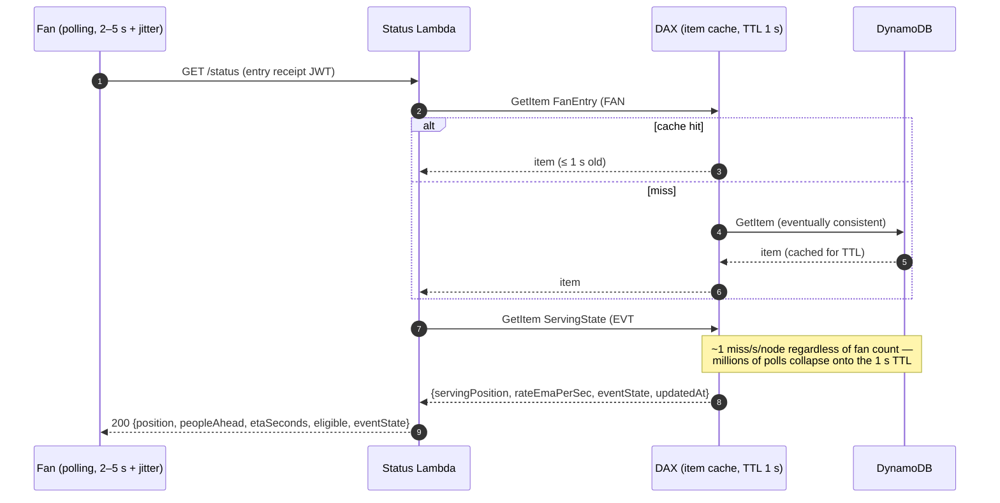

# D4 — Fan Status Queries Under Mass Polling

> **Deliverable D4:** Low-latency reads for each fan's current position, estimated wait time,
> and eligibility status — sustained while millions of fans poll simultaneously.

## 1. The read problem, stated precisely

Design point: 1,000,000 concurrent pollers at a 3 s interval → **~333,000 requests/s**, each
needing (a) the fan's own state and (b) the global serving threshold.

The two reads have opposite characters, and the design treats them oppositely:

| Read | Key | Cardinality | Character |
|---|---|---|---|
| Fan's own `FanEntry` | `FAN#<fanId>` | 10M distinct keys | uniform — DynamoDB's favorite shape; no partition ever hot |
| `ServingState` singleton | `EVT#<eventId>` | **1 key** | pathological — 333k reads/s against one item, ~55× beyond a single partition's ~3,000 RCU/s (~6,000 eventually-consistent reads/s) ceiling |

Without a cache, the `ServingState` read is not merely expensive — **it is impossible**. One
item lives on one partition; no amount of on-demand scaling or adaptive capacity splits a
single item. This is why DAX is a required component of the read path, not an optimization
(Decision E).

Eligibility being *derived* (`pos ≤ serving`, Decision C) is what makes this shape possible
at all: nobody has to write eligibility to millions of items, so nobody has to read fresh
per-fan eligibility either — one hot-but-cached singleton plus one immutable-ish per-fan item
answers everything.

## 2. Component spec: Status API — `GET /events/{eventId}/status`



Both reads go **through DAX, eventually consistent**. Writes never touch DAX (write path is
Lambda → DynamoDB directly); the admission path bypasses DAX entirely with strongly
consistent reads ([doc 03 §5](03-batch-promotion.md#5-component-spec-admission--post-eventseventidtoken)).

## 3. What the client computes

The API returns raw ingredients; display math is client-side (cheap, smooth, no server state):

```
peopleAhead = max(0, queuePosition − servingPosition)
etaSeconds  = peopleAhead / rateEmaPerSec          (clamped, smoothed client-side)
eligible    = queuePosition ≤ servingPosition
```

- `rateEmaPerSec` is maintained by the promoter inside `ServingState`
  ([doc 03 §3](03-batch-promotion.md#3-the-promoter-algorithm-deficit-driven)), so ETA needs no
  extra read.
- **No position yet** (fan polls before the sequencer reaches their bucket — up to ~30–60 s
  after entry): respond with a "securing your place in line" state. The entry receipt proves
  they are in; the position claim JWT is attached once `queuePosition` exists.
- `eventState` is surfaced verbatim so clients render `PAUSED`/`CLOSED` messaging without a
  separate endpoint.

**Polling protocol:** 2–5 s interval with per-client jitter (breaks synchronization waves),
exponential backoff on non-200s, and `Cache-Control: max-age=1` on responses so a CDN/API
Gateway cache layer can be added in front **without redesign** — the response is already
built from data that is (deliberately) up to ~1 s stale.

## 4. Staleness bound, and why it is safe

Worst-case a fan learns they are eligible late by:

```
staleness ≤ DAX TTL (1 s) + poll interval (≤ 5 s) ≈ 6 s
```

This is a **UX artifact, never a correctness issue**, for one reason stated once and reused
everywhere: `servingPosition` is monotonic. A stale threshold is always ≤ the true one, so a
stale read can only under-report eligibility — it can never show eligibility that doesn't
exist. The moment that matters (admission) re-checks everything strongly consistently inside
a conditional transaction ([doc 03 §4](03-batch-promotion.md#4-why-over-promotion-cannot-overwhelm-purchasing-the-two-layer-control)), which is the hard cap. The status
API may lag within the bound; the admission API is exact.

## 5. The math under mass polling

### 5.1 `ServingState` (the read that had to be tamed)

With DAX item-cache TTL = 1 s and an N-node cluster, each node refreshes the item at most
once per second:

```
DynamoDB reads/s for ServingState ≈ N × (1 / TTL) = N reads/s      (N = 3–10 → ~3–10 reads/s)
```

333,000 requests/s collapse to single-digit reads/s against the table — a 5 orders-of-
magnitude reduction, and the hot-partition problem disappears entirely.

### 5.2 Fan items (the part the cache does not help)

A fan polling every 3 s across an N-node cluster lands on a given node every ~3N s, far past
the 1 s TTL — so **per-fan reads mostly miss** and pass through to DynamoDB. That is fine by
design: the keys are uniform, DynamoDB absorbs ~333k eventually-consistent GetItems/s
(~167k RCU/s) with warm read throughput, with zero hot partitions. The fan-item reads *do
not need* the cache; routing them through DAX anyway keeps the client code single-path, and
every repeat-read within 1 s (retry storms, gateway retries) is absorbed free. The knobs if
cost matters more than freshness: raise the cluster-wide TTL (fan items are immutable
post-sequencing except the admission flip; `ServingState` freshness is the constraint that
holds TTL at 1 s), or split clusters / route fan reads direct — both analyzed in
[doc 07 §3](07-tradeoffs-and-alternatives.md#3-edge-caching-vs-dax-for-the-serving-state) and
[doc 06](06-scaling-and-cost.md#4-read-path-cost-dax-vs-no-dax).

### 5.3 Request-cost table (1M pollers, 3 s interval, 1 h)

| | reads/s to DynamoDB | RCU/s | 1-hour read cost (on-demand, us-east-1 reference $0.125 / M RRU, eventually consistent = 0.5 RRU) |
|---|---|---|---|
| No DAX — fan items | 333,333 | 166,667 | `333,333 × 0.5 × 3600 / 1e6 × $0.125 ≈ $75` |
| No DAX — ServingState | 333,333 | — | **throttles; not a cost line, an outage** (§1) |
| With DAX — fan items (~all miss) | ~333,333 | 166,667 | ≈ $75 |
| With DAX — ServingState | ~N ≈ 5 | ~2.5 | ≈ $0.001 |
| DAX cluster (3× `dax.r5.large`, 1 h) | — | — | ≈ 3 × $0.25 ≈ **$0.75/h** (see [doc 06](06-scaling-and-cost.md) for sizing to full 333k ops/s) |

The point of the table: DAX's job here is not saving the ~$75/h of uniform reads — it is
making the singleton read *exist at all*, for under a dollar an hour.

### 5.4 Latency

DAX cache hits return in sub-millisecond to low-single-digit ms; misses add one
eventually-consistent GetItem (single-digit ms p99). End-to-end (CloudFront → API Gateway →
Lambda → DAX) comfortably delivers the "low-latency" requirement at p99 < ~50 ms, dominated
by the HTTP path rather than the data layer.

## 6. Failure modes

| Failure | Behavior | Why it is safe |
|---|---|---|
| DAX node failure | cluster serves from remaining nodes; misses pass through to DynamoDB | fan-item reads are pass-through-tolerant by design (§5.2); ServingState refresh load is N reads/s |
| Full DAX cluster outage | status API degrades: fan items fine (uniform), ServingState must be protected — Lambda falls back to a per-container memoized read (≥ 1 s in-memory TTL), same collapse effect | the 1 s staleness contract is already the API's contract; admission path never depended on DAX |
| Cache serves stale ServingState | eligibility under-reported by ≤ 1 s | monotonic threshold (§4) |
| Poll storm (clients ignore backoff) | WAF rate limits per client; DAX absorbs repeat reads within TTL | edge layering ([doc 01 §5.2](01-table-design.md#52-edge-assumptions-breadth-belongs-elsewhere-depth-belongs-to-dynamodb)) |
| Region-level DynamoDB read throttling | SDK backoff + jittered client retry; warm read throughput sized in [doc 06](06-scaling-and-cost.md) | uniform keys mean throttling is capacity-wide, not partition-local, and warm throughput prevents it |
